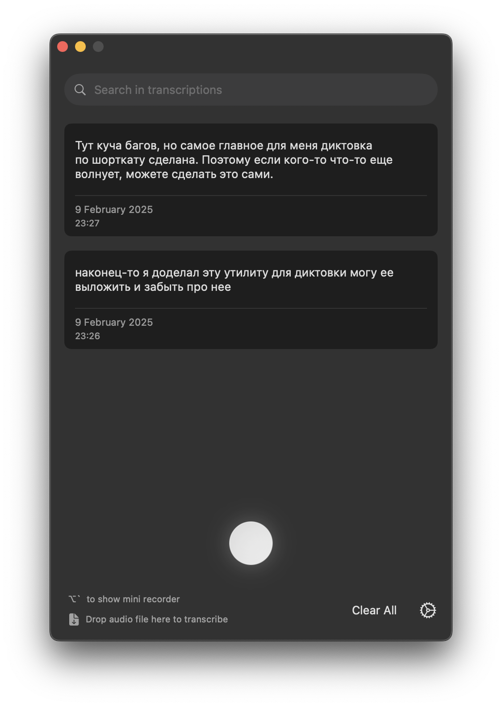

# OpenSuperWhisper

OpenSuperWhisper is a macOS application that provides real-time audio transcription using the Whisper model. It offers a seamless way to record and transcribe audio with customizable settings and keyboard shortcuts.

> **This tree is a fork of [Starmel/OpenSuperWhisper](https://github.com/Starmel/OpenSuperWhisper) (MIT).**
> Everything the original does is still here; on top of it this fork adds local tone, clean-up and e-mail rewrites
> for **Polish and English dictation** — two models, two jobs: one normalizer for English clean-up alone, one
> instruction follower for tone and the e-mail mode in both languages — a deterministic clean-up pass that needs
> no model and works in any language, a profanity guarantee that is a function rather than the model's judgement,
> keystroke delivery that leaves the clipboard alone (and reaches a Citrix session or a virtual machine through
> the clipboard, which is restored), and a repaired long-form decode path.
> Section [What this fork changes](#what-this-fork-changes) describes every difference in detail, and
> [What is unchanged](#what-is-unchanged) lists what is inherited verbatim.
>
> **The `brew install` line and the release links below install the *original* app, not this build.** This fork
> publishes no binary downloads: it is built from source ([Building locally](#building-locally)), and its work lives at
> `main` in this fork's own repository ([23n0n/OpenSuperWhisper](https://github.com/23n0n/OpenSuperWhisper)) —
> nothing has been sent upstream, and no pull request is open against it.

<p align="center">
 
</p>

## Features

- 🎙️ Real-time audio recording and transcription
- 🧠 Three transcription engines: [Whisper](https://github.com/ggerganov/whisper.cpp), [Parakeet](https://github.com/AntinomyCollective/FluidAudio) and [Qwen3-ASR 1.7B](https://huggingface.co/ggml-org/Qwen3-ASR-1.7B-GGUF) (the vendored llama.cpp's own audio encoder) — download models directly from the app (Parakeet: v3 and v2, plus **Redux**, moondream's 219 MB ternary re-training of v3)
- ⌨️ Global keyboard shortcuts — key combination or single modifier key (e.g. Left ⌘, Right ⌥, Fn)
- 🖱️ Mouse button trigger — bind the middle or an extra (thumb) mouse button to start/stop recording
- ✊ Hold-to-record mode — hold the shortcut, modifier key or mouse button to record, release to stop
- 📁 Drag & drop audio files for transcription with queue processing
- 🎤 Microphone selection — switch between built-in, external, Bluetooth and iPhone (Apple Continuity) mics from the menu bar
- 🌍 Support for multiple languages with auto-detection
- 🇯🇵🇨🇳🇰🇷 Asian language autocorrect ([autocorrect](https://github.com/huacnlee/autocorrect))

### Added by this fork

- 🌐 **Local tone, clean-up and e-mail rewrites, in Polish and English** — two models, two jobs, both running
  inside the app (llama.cpp linked in, no server, no port); two independent switches plus a spoken e-mail mode,
  off by default. Tone and the e-mail mode run on an instruction follower, English clean-up alone on a smaller
  normalizer. The transcript is rewritten in place, in its own language: **the app never changes the language of
  your dictation**. Saying e.g. “dyktuję maila” at the start of a dictation selects the e-mail mode (also
  “dyktuję mejla”, “napisz maila”, “dyktuję email”, inside the first four words): the phrase is taken off the
  front and the rest is shaped into a greeting, body paragraphs, a polite closing and a sign-off — no subject
  line, no placeholders, no Settings switch, no second hotkey. A trigger with nothing after it is discarded as an
  empty dictation
- 🇬🇧 **English clean-up runs on S1-mini by Superwhisper (462 MB, ~1 GB of memory).** **Tone — Polish and English
  alike — and the e-mail mode run on Qwen2.5 7B Instruct (4.68 GB on disk, ~5.3 GB of memory while a rewrite
  runs).** With *Clean up dictation* on, Polish still gets the deterministic scrub (§4): fillers, stutters,
  Polish affixes, casing and diacritics, none of which needs a model — and a Polish clean-up is that scrub alone.
  The card says what each model costs and what happens without it: a job whose file is missing is delivered as
  transcribed (English clean-up as the scrub's output), with a notice naming the file to fetch — nothing is
  substituted silently, and the other job keeps working
- 🛡️ **A rewrite that answers instead of rewriting never reaches your text** — a deterministic guard rejects an
  assistant frame ("Sure,", "Oczywiście,"), a label line, the prompt's own `TRANSCRIPT`/`TRANSKRYPCJA`
  delimiter, a stub or a language flip, and pastes your own words with a notice instead. It reads text only:
  no second model call, so it cannot invent anything itself. Profanity is taken out earlier, by a function
  rather than the model: the words are neutralised before any model sees them, and a model that then refuses
  the job or invents a `[placeholder]` has its answer thrown away, so the dictation is delivered already
  neutralised, with a notice that the rewrite did not happen
- 🧭 **Auto-detected language, always** — the engine measures the language of every utterance (no language
  picker); a transcript nothing can place is pasted raw, untouched
- 🛡️ **English-only model guard, and a second reading of the same audio** — an `.en` model cannot detect
  anything, so when the transcript it produced is not English the app says so and offers the multilingual model
  instead of keeping the invented text; and because fluent English over Polish speech *is* English, the same
  recording is decoded a second time with the decoder prompt flipped, and a transcript the second reading does
  not contain is refused the same non-destructive way (numbers in §3)
- 🧹 **Dictation clean-up, in two halves** — the scrub is deterministic and needs no model: filler words,
  `hmm`, `aaa`, stutters and repeats are removed, and the sentence's own language is repaired (Polish affixes,
  casing, diacritics), in whatever language was spoken. The grammar repair — punctuation, articles, word order —
  is the model's: alone it is English-only and runs on S1-mini, and with a tone on it rides the *same* single
  transform call, in Polish or English
- 📚 **Reference / glossary field** — names and terms fed into the transform prompt. It rides the instruction
  model's prompt (tone and e-mail); S1-mini's fixed input format has no slot for a list, so English clean-up
  alone does not get it, and the card says so rather than pretending the list reaches S1-mini
- 🧯 **A transform that did not run says so, and offers its fix** — a failed call names the job that did not
  happen (*Tone rewrite could not run*, *Clean-up could not run*, *Tone rewrite and clean-up could not run*, or
  *The e-mail rewrite could not run*), and for the
  failures the app can repair — a weight file that was never downloaded, and one that is on disk but does not
  match its pinned checksum — the notice carries a button that opens the Settings card the weights live on. The
  transcript is still delivered, and a cancelled dictation stays silent
- ⌨️ **Keystroke delivery** — the transcript is typed into the focused app as synthetic keystrokes, which no
  keyboard layout changes and which leave the clipboard alone; a Citrix session, a virtual machine or a remote
  desktop, where keystrokes arrive as key codes instead of text, gets it through a clipboard paste that restores
  what was there (numbers in §5)
- 🔒 **Accessibility only** — Input Monitoring is no longer used or required anywhere, and no permission screen
  blocks the app
- 📊 **Last-dictation card** — the detected language and the raw, cleaned and final text of the last dictation
- 🗂️ **Model storage controls** — installed models listed with the one in use, SHA-256 verification against the
  digest each publisher reports, removal with the space it frees
- 🧯 **Long-form audio fix** — dictation longer than 30 s no longer skips audio
- ⏸️ **A long pause ends the sentence** — a switch (off by default, with the reason measured in §8) that keeps the
  pause the speaker left instead of dissolving it into a 0.1 s breath, so a pause cannot split a thought into a
  fragment or run two thoughts together — Polish in particular, where the model's punctuation is weaker than
  English's
- 🧾 **Readable settings, reachable settings** — the Settings sheet lays out correctly, and the status-bar menu
  reaches it even with the main window closed
- 📦 **One-package install, one-operation uninstall** — from inside the app
- 🛠️ **Developer tooling** — identity-signed builds whose permission grants survive rebuilds, one build script for
  the vendored engines, and a contract check for the installer

## What this fork changes

Written against the delivery branch `feat/local-translate-tone`. The plain-language sections were checked against
that tree at `81bc968` (2026-10-02) — the revision that took the 8B out of the catalogue and gave a failed
transform a notice with its fix. §1, the list above and the transform reference were rewritten again for the
two-model transform (S1-mini for English clean-up, Qwen2.5 7B for tone and e-mail in both languages) that this
tree carries. Every claim below was checked against the current tree, and the numbers were produced by running
the code, not by reading it.
To see the whole delta yourself:

```shell
git fetch upstream        # upstream = https://github.com/Starmel/OpenSuperWhisper.git, already a remote here
git diff upstream/develop...feat/local-translate-tone
```

**Scale.** 54 commits of its own on top of `upstream/develop` (69 including merges), touching 78 files:
**+12,995 / −715** lines. 42 files are new, 35 are upstream files with changes, and one file moved
(`ggml-tiny.en.bin` into the app bundle directory). Those 42 new files — app sources, tests, build scripts,
packaging and the vendored `libllama/` — are the fork's own; everything else in the tree — the two engines, the
shortcuts, the queue, the model catalogue, the onboarding — is upstream's, edited where a feature required it.

Paths below are relative to `OpenSuperWhisper/` unless they start with `Scripts/`, `packaging/` or `libllama/`.

### 1. Tone, clean-up and e-mail, inside the app — Polish and English

Upstream transcribes; it has no notion of tone and no rewriting pass at all. This fork adds two independent
switches in **Settings → Transcription** ("Apply tone" and "Clean up dictation"), plus an e-mail mode selected by
what the dictation opens with, all riding models that run **inside the app**. Tone and the e-mail mode work in
**Polish and English alike** — Polish tone is new, and the deterministic scrub is still what Polish clean-up is.
English clean-up alone runs on a smaller normalizer. There is no direction change anywhere in the product: a
rewrite keeps the language it was spoken in, and no prompt can move the text into another one.

The rewrite is performed **in-process** by two models, and they are the whole catalogue. `S1-mini by Superwhisper`
(Q4_K_M, 462 MB on disk, about 1 GB of memory while loaded) is a 0.6B text normalizer trained for exactly this
job — raw ASR text in, clean written text out: fillers removed, false starts and self-corrections resolved,
punctuation and capitalisation applied, and spoken numbers, dates, times, currency and email addresses written
out. It is not an instruction follower: it takes one exact system prompt and a fixed control line,
`[Styling: semi-formal] [Structure: prose] [Context: general]`, so the app composes that format for it instead of
its own instruction, and asks for its answers greedily, as the model's card requires. It reads English only, and
it serves English clean-up alone. `Qwen2.5 7B Instruct` (Q4_K_M, 4.68 GB on disk, about 5.3 GB of memory while a
rewrite runs — the engine's accounting, not a wired measurement) is the instruction follower that serves **a tone
and the e-mail mode, in Polish and English**; it is roughly ten times the normalizer's size because it has to read
both languages and follow a register, and nothing loads it until a tone switch or the e-mail trigger asks for it.
**Nothing stands behind either model**: the 1.5B instruction follower an earlier build fell back to, and the
larger 8B before that, are gone from the app rather than left in the list unrouted, so a machine without a weight
file gets its transcript back with a notice naming the file to download instead of a rewrite from a model nobody
chose. Both files are downloaded on demand into the app's own Application Support folder and verified against
their pinned checksums before use. llama.cpp is vendored as `libllama/` and linked into the app exactly like
whisper.cpp, so there is no background server, no listening port and no endpoint override:
`OpenSuperWhisper/TransformService.swift` is the only way the text can be rewritten.

**Tone is measured, not assumed.** With the 7B, the input `no kurwa, ten plik jest do dupy, musimy to ogarnąć na
dziś, bo klient czeka` came back as `Ten plik nie jest do przyjęcia, musimy to rozwiązać dzisiaj, ponieważ klient
czeka.` — the register changed, the profanity gone, the commitment kept. The same holds for English.

**The e-mail mode is spoken, not configured.** Saying e.g. `dyktuję maila` at the start of a dictation selects
the mode — accepted variants include `dyktuje`, `napisz`, `mejl`, `meila` and `email`, inside the first four
words. There is no Settings switch and no second hotkey. The phrase is taken off the front and the rest becomes
the body, shaped into a greeting, body paragraphs, a polite closing and a sign-off — no subject line, no
placeholders. A trigger with nothing after it is discarded as an empty dictation. `Utils/DictationTrigger.swift`
holds the matcher.

**Profanity is guaranteed, not attempted.** Before any model runs, `ProfanityScrubber` — a function, like
`DictationScrubber` — replaces profanity and crude slang with neutral wording that carries the same meaning
(`ten plik jest do dupy` → `ten plik jest nie do przyjęcia`). It exists because the guarantee is absolute and a
model cannot be trusted with it: measured across five candidates from 135 M to 7 B, the Polish profanity survived
in most of them, and a model that removes the word today may leave it tomorrow. So a tone takes the word out
because it is already gone, not because the model decided to. If the model then refuses the job or invents a
bracketed placeholder, the deterministic `TransformAnswerCheck` throws the answer away and the dictation is
delivered **with the profanity already neutralised**, with a notice saying the rewrite did not happen. The prompt
carries the two rules this needs, both measured: never refuse (an insult is a dictation, not a request to the
model) and invent nothing (no headings, quotes or placeholders).

**A transform that did not run says so, and offers its own fix.** A failed call used to leave nothing but a
`print`: a machine with no weight file downloaded pasted the raw transcript and said nothing, so a rewrite that
never ran looked exactly like a switch that was off. The failure is now a notice naming the job that did not
happen — `Tone rewrite could not run`, `Clean-up could not run`, `Tone rewrite and clean-up could not run`, or
`The e-mail rewrite could not run`, the third because one call carries both those jobs and a title naming only
the tone would under-report it. Where the
app recognises the failure it offers the remedy as a button: `TransformModelError.notInstalled` and the new
`.notVerified` both open **Settings → Transcription**, the card that lists the weights and can download either
one again — a file that is not there and a file that is there but does not match its pinned checksum are two
problems (`TransformRuntime` now tells them apart, where `verifiedPath` returned `nil` for both) with one fix.
Every other failure — a failed load, a failed decode — keeps the plain alert and the runtime's own words rather
than a fix that would not repair it. The transcript is still delivered, and a cancelled dictation is not a
failure: it is discarded by the caller and stays silent.

### 2. The language is auto-detected, and never changed

The decision is a table (`TransformPolicy` in `TransformService.swift`), not a per-call guess, and it is fed by the
language the speech engine reports *for that same utterance* — whisper's own detection, the only mode there is
now that the **Language picker is gone from Settings, onboarding and the menu bar** — or by the text heuristic in
`Utils/LanguageDetector.swift` (Polish diacritics, function words, bigrams) for engines that cannot report one,
such as Parakeet. `params.language` is always `nil` and `params.detectLanguage` stays `false`. The rules that
matter:

- **The job decides the model, the language second.** Tone and the e-mail mode run on the instruction model, in
  Polish or English. Clean-up alone in English runs on S1-mini. Clean-up alone in Polish resolves to no model
  call at all: the deterministic scrub *is* Polish clean-up. A transcript in a third language — or one nothing
  can place — is pasted raw.
- The transcript is rewritten **in its own language**: Polish in, Polish out; English in, English out. There is
  no target language in the product, and no prompt that could move the text into another one.
- Both switches off, and no e-mail trigger spoken, is the default install: **no model call at all**, and the
  transcript is bit-for-bit what the engine produced.
- A transcript nothing could place (an engine that reports nothing, and a text too short for the heuristic) is
  pasted raw; no model is asked to guess its language.
- Tone no longer rides on anything: it is a same-language rewrite, so it needs no other switch to be on — and a
  tone or the e-mail trigger is enough on its own.

The full switch table is in [Tone, clean-up and e-mail](#tone-clean-up-and-e-mail-polish-and-english) below.

### 3. English-only model guard, re-keyed to the transcript

An `.en` whisper model cannot detect a language at all, and with the language picker gone there is no setting left
to compare against — so the evidence is the text the model produced. `Utils/SpeechModelLanguageGate.swift` reads
the transcript with the same `LanguageDetector` heuristic the transform uses, and when an English-only model's
transcript is not English (the captain's own case: `ggml-tiny.en.bin` writing confident English over Polish
speech) the dictation is refused with a notice naming the model *and* what the dictation looks like, plus the
multilingual model already on the machine as a one-click remedy. English dictation can never be caught by it — and
that verdict is evidence only from **four words** up: measured on his recordings plus the repository's labelled
fixtures (122 labelled items), the heuristic agrees with the truth 36.4% of the time at one word, 54.2% at two,
79.2% at three, 92.9% at four to five and 100% at six to ten (one miss in the fourteen four-to-five-word items),
so below four words the gate refuses nothing — an English *Miami*, *nowadays* or *brownie*, every one of them read
as Polish, is dictated rather than refused.

**The half that heuristic cannot see is a comparison.** The two failures the app actually stored for him on
2026-09-25 — `I'll see you later. Bye!` and `I'm not going to be able to say that.…`, read out of his own
`recordings.sqlite`, over recordings of Polish speech — are English text, so the heuristic sees nothing wrong, and
the audio carried speech, so the no-speech refusal sees nothing wrong either. The same recording is therefore
decoded a **second time** and the reading itself is the evidence: same model, same audio, same settings, with
exactly one thing flipped — the decoder prompt decision (`WhisperEngine.secondReadingPrompt`: a transcription
that sent a prompt is read again with none, and one that sent none is read again with the default its language
has; an English-only model is English by construction). A transcript that only exists while the decoder has been
*handed text* is text the model wrote, not words it heard.

`SpeechModelLanguageGate.corroborationConflict` refuses when the second reading holds **under 70% of the
transcript's words and at least three of them are missing** (the floor is what keeps a three-word dictation from
being refused over one word; a script that writes without spaces is one word and is never judged). The floor and
the short-text guard are **chosen from the two measurements below** — the middle of the gap they leave, with the
upper margin against the worst reading the app's own path produced and the lower margin against the closest
invention the probe produced — not derived from anything.

**Through the app's own code path** (`SecondReadingOnRealAudioTests`, opt-in, the test host running the shipped
`WhisperEngine` and `SpeechModelLanguageGate` over the captain's recordings in
`~/Library/Application Support/ru.starmel.OpenSuperWhisper/recordings/`, read-only, with the multilingual model
installed on that machine, 2026-09-28): of the 27 files there, 9 carry audio and 8 produced a transcript long
enough to judge. Six corroborate **every** word; the two that do not are his English dictations at **96.1%**
(51 words) and **82.6%** (23 words, 4 words lost). **82.6%** is the worst legitimate reading measured on the
shipped path, and what the floor's upper margin is against.

**With `whisper-cli`** — the vendored whisper.cpp built as its own binary, a separate tool run outside the app,
so everything in this paragraph is a probe of the **model's** behaviour and not of the app's path — on the same
recordings and on the repo's fixtures: his Polish is word-for-word identical under seven configurations of the
same audio (greedy, sampling at temperature 0.4, beam search, no temperature fallback, the un-trimmed VAD path, a
prompt in the wrong language, the app's own prompt) — 35 pairs, no word lost; the long English fixture sits at
98.6% (280 words); and `ggml-tiny.en.bin` writing English over that same Polish speech shares **0%** of its words
with the second reading on four of the five recordings and **50%** on the fifth (the 2.4 s one, where it writes
"This is today." twice in a row). The two transcripts the app stored share **0%** with what `whisper-cli` reads
the same audio as today. **50%** is the closest an invention came to being corroborated, and what the floor's
lower margin is against.

**The probe is deterministic**: repeating one `whisper-cli` invocation twice gave byte-identical output in all
three invocations compared that way — the greedy decode of one recording, the temperature-0.4 decode of one
recording, and the English-only model with a prompt on one recording — so a disagreement is the model's, not the
sampling's.

So the floor leaves **12.6 points** above the worst legitimate reading (0.826, shipped path) and **20 points**
below the closest invention (0.500, probe). The false-refusal rate measured is **0 of the 8 judged readings
through the shipped path**, and separately **0 of the 35 legitimate configuration pairs** through the probe —
two populations, two rates, both zero. No second reading — no prompt to flip to, a decode that failed, a
transcript too short to judge — refuses nothing, and the refusal is the same non-destructive one as the two
above: no transcript row and nothing pasted, while the recording itself is kept as a failed row so it stays findable, and a message about the two readings that does not read like
either of the other refusals.

### 4. Dictation clean-up and the reference field

Two more controls in **Settings → Transcription**. **Clean up dictation** removes filler sounds, drawn-out
vowel runs, stutters and false starts, and repairs the sentence language (Polish affixes, casing, diacritics) —
deterministically in `Utils/DictationScrubber.swift`, and where grammar is at stake through the *same* single
transform call the tone already uses: measured on the captain's own recordings with S1-mini, English clean-up
**adds no model call** where a tone rewrite is already happening (the clean-up wording travels inside that
prompt), and it adds exactly **one** call — median 0.17–0.38 s — where the app previously made none, which is a
dictation with clean-up on and the tone switch off. A Polish clean-up is the deterministic scrub alone: no model
policy resolves and no model is called. The deterministic scrub itself costs ~0.13 ms. **Reference** takes free
text — names, product terms, jargon — and passes it into the instruction model's prompt (tone and e-mail) so the
model stops mangling them; S1-mini's fixed input format has no slot for it, so English clean-up alone does not
get it.

The last dictation is inspectable in the app: `DictationReport.swift` records the detected language plus the raw,
cleaned and final text, and the main window shows them side by side. History always keeps the raw transcript.

### 5. Delivery: synthetic keystrokes, and the clipboard for a redirected target

Upstream types the transcript by putting it on the system pasteboard and sending ⌘V
(`ClipboardUtil.insertText` / `sendCmdV`), which overwrites whatever the user had copied. This fork delivers by
synthesising the keystrokes instead (`Utils/KeyboardSimulator.swift`) — each character carrying its text in the
event's text field under the key code and modifiers the active layout produces it with — so no native target's clipboard is read or written, and the layout-dependent keycode translation is covered by `KeyboardSimulatorTests`.
Keystrokes that the system refuses to deliver are reported instead of being dropped silently. This also means
Accessibility — not Input Monitoring — is the grant that matters; see the next point.

The keystroke path is not, however, the whole story, and the day the captain dictated into a **Citrix session** and
read back spliced, repeated text is why. A synthetic key event carries its text in an Apple-specific field, and a
target that redirects input into another machine — a Citrix session, a virtual machine, a remote desktop — may
never look at that field: measured on this machine, the Citrix client's own viewer taps the keyboard events, reads
key codes and modifier flags, and links **no** Unicode-payload reader at all. So the session must rebuild
characters from key codes, under a keyboard layout this app neither controls nor knows. Two changes came out of
that (`Utils/TextDelivery.swift`, `Utils/KeyboardSimulator.swift`):

* **One character per key pair, and it travels once.** Both events of the pair used to carry text — twenty
  characters' worth of it — and carrying text on the release is a duplication hazard in any target that inserts
  what each event carries: the window arrives twice, the second copy at the caret the first had already moved. A
  pair now carries **one character**: it has exactly one key code, so anything beyond that character's own key is
  lost to a target that rebuilds characters from key codes, which is what a redirected target does. The text is on
  the keyDown only; the keyUp stays, and keeps the keyDown's key code *and modifiers*, so a host tracking key
  state sees a release rather than a stuck key, and its Unicode field is *cleared* to length zero rather than left
  unset, because an unset field reads back as the character the key code makes. **This is a hazard removed, not a
  cause proven**: no capture of the failing target's event stream exists. The cost is event volume: about a
  thousand events for a 487-character dictation instead of about fifty, which is why there is a small delay
  between one character and the next (`KeyboardSimulator.defaultInterCharacterDelay`, 2 ms, about 500 characters a
  second).
* **The key code is no longer hardcoded to 0, and it carries the modifiers its character needs.** Key code 0 is
  the `A` key on ANSI layouts, and a target that rebuilds characters from key codes used to type `a` once per
  character — every character — because every event was posted on key 0. The key now comes from the active layout,
  for the character that event carries, resolved across all four
  layers — none, Shift, Option, Shift+Option — and the event carries **that layer's modifiers with it**. On the
  layout active on this machine `ą` is Option+A, `ś` Option+S, `ó` Option+O, `ź` Option+X, `Ś` Option+Shift+S; every
  one of those used to be posted as key code `0x7F` — the code for no key at all — with no modifiers, which no
  target can turn into a character. A character the layout produces on no layer (CJK, Cyrillic, emoji) carries
  `0x7F` and no modifiers, because there is no key to press. Key plus modifiers is what a physical keyboard sends,
  which is exactly what a HID-forwarding client forwards.
  **What a key code cannot do, stated where it applies**: it is right only for a target whose keyboard layout is
  the same as this one. The sender cannot see the target's layout and no key-code scheme can, so a redirected
  target set to a different layout produces different characters from the ones dictated (an independent judgment
  put "the layout mismatch remains" at **0.61**). That is why the recognised clients get the clipboard path, and
  why this is the keystroke path's character-level fix rather than a solution to redirected targets on its own.
  **What this does not claim, because an independent audit of this change measured it otherwise**: key code 0 can
  still be *resolved*. On the layout active here (`com.apple.keylayout.PolishPro`) key 0 *is* the `A` key, so a
  character that is `a` or `A` legitimately carries key code 0. That is correct for
  a native macOS target — its text arrives in the event's Unicode field whatever the key code is — and it is a
  residual: a redirected target that ignores the event's text field reads that one character and nothing else.
  The measured clients take the clipboard path instead, and **Delivery** in Settings overrides the whole rule.
* **The mechanism follows the target class** (`TextDelivery`): keystrokes into a native macOS application, and the
  clipboard paste for an application that redirects input elsewhere. The rule has two tiers and the difference
  between them is deliberate — one is measured here and one is not:
  * *measured* (`verifiedRemoteClientBundleIdentifiers`): the bundle identifiers read out of the installed and
    running applications on this machine — Citrix Viewer `com.citrix.receiver.icaviewer.mac` (seen frontmost,
    `active=true`, with a session up), the Workspace UI `com.citrix.receiver.nomas`, the engine
    `com.citrix.HdxRtcEngine`, Parallels Desktop, macOS Screen Sharing. A match here pastes;
  * *a judgement* (`remoteClientVendorPrefixes`): the same clients' vendor families — `com.citrix.`,
    `com.parallels.`, `com.teamviewer.`, VMware Fusion, VirtualBox, UTM, QEMU, Microsoft Remote Desktop, Jump
    Desktop, Screens, RealVNC, TigerVNC, AnyDesk, Parsec, RustDesk, Chrome Remote Desktop, NoMachine. An
    independent reading put "a prefix rule is safe" at **0.36**, so a prefix-only match **does not paste unless
    the user switches on** *Paste into other apps from these vendors* in Settings: an uncertain match fails
    toward the behaviour that does not touch the clipboard.
  **This is a deliberate change to the doctrine above**: "the clipboard is never used" is no longer
  unconditionally true. Accessibility insertion was rejected because a session exposes no host-side text element
  to write into, and real per-character key codes because they cannot reproduce arbitrary Unicode on a target
  whose layout is unknown.
* **The clipboard path's crash hole is closed on disk by `ClipboardRecovery`.** The previous contents are put
  back 1.5 s after the paste — proved on the machine's real pasteboard, byte-identical, in
  `DeliveryMeasurementTests` — but that restore is an in-process block, and a measurement showed what a process
  that dies inside that window leaves behind: the transcription on the clipboard and the user's own contents
  gone. So the displaced clipboard is written to `~/Library/Application Support/ru.starmel.OpenSuperWhisper/
  clipboard-recovery.plist` (`0600`, readable by that user alone) **before** the pasteboard is touched, and the
  next launch puts it back if the record is still there — proven in `ClipboardRecoveryTests`, which kills a child
  process built from the app's own code and then runs the same recovery entry point the launch runs. The record
  is cleared as soon as the delivery restores the clipboard itself, and recovery puts the contents back when the
  clipboard still holds this app's text or when it holds nothing at all (see the last entries of the list below).
  The test is content-based, not identity-based: it compares the digest of the text that is on the clipboard with
  the digest of the text the delivery wrote, so a third party who wrote the *byte-identical* transcription after a
  crash would still be overwritten. An independent audit measured that window and called it negligible; it is
  stated here rather than left implied.
* **What remains unclosed, stated rather than hidden.** Seven paths; all but the first are silent:
  * **An application that redirects input elsewhere but is in neither tier takes keystrokes, and therefore gets
    the mangling this whole change exists to remove.** The measured tier is five bundle identifiers read off this
    machine; the vendor-prefix tier is a judgement and is **off by default**; anything else — a client from a
    vendor with no prefix, or a bundle of a listed vendor that is not in the measured set — is typed into, and a
    target that rebuilds characters from key codes reads that as key codes. This is the one gap that reproduces
    the original defect, and an independent judgment put "acceptable as a documented cost" at **0.18**. What
    closes it is coverage (adding a client's bundle identifiers to the measured tier, which needs that client on
    the machine) or the vendor switch, not a better key code.
  * A target that services the paste *later* than the restore gets the **restored** clipboard contents — the
    user's own previous clipboard pasted into their document instead of the dictation (measured case:
    `TextDeliveryTests`).
  * An app killed between the copy and the restore keeps the transcription on the clipboard until the next launch
    puts the old contents back — unless the record could not be written: **a record-write failure is silent**, and
    its cost is the user's clipboard rather than their text (they keep the dictation in History; what is lost is
    what they had copied). Nothing reports it.
  * If the session has clipboard redirection switched off, the paste delivers **nothing at all** and this app
    cannot tell, because the only thing it can observe is its own pasteboard. The once-per-install notice says the
    dictation went through the clipboard and what a silence means — **once**, never again, so a later session
    without clipboard sharing is silent, and after that notice the Settings copy and the delivery record are the
    only places the mechanism is visible.
  * **A redirected target with a different keyboard layout produces different characters.** The keystroke path now
    sends the key and the modifiers this machine's layout uses, character by character; the target's
    layout is not visible to the sender, so `ą` arrives as whatever *its* Option+A means, and a target whose layout
    has no such combination may produce nothing for that character. Nothing in this app can fix that — it is a property
    of the client's layout configuration — and it is why the recognised clients are given the clipboard instead
    (an independent judgment put "the layout mismatch remains" at 0.61).
  * **A pasteboard emptied deliberately is filled again.** Recovery puts the displaced contents back when the
    clipboard still holds this app's text *or* when it holds nothing at all — the empty case because nothing of
    anyone's can be taken from an empty board and because that is what a reboot leaves, and this is the case the
    disk record exists for (an independent judgment put restoring into an empty board at **0.85**, against 0.12
    for always refusing). The cost: a board cleared on purpose, or one that is empty because there is no clipboard
    in the current context, is indistinguishable from a reboot and gets the old contents put on it.
  * The protected clipboard itself is written and restored on the paste path, so a target that reads it *while*
    the transcript is on it sees the transcript — that is the mechanism, stated here so it is not a surprise.
  `Settings → Transcription` offers **Delivery** (Automatic, Keystrokes only, Clipboard paste) plus the vendor
  toggle: "Keystrokes only" turns the clipboard path off entirely, and every dictation's unified-log line records
  `mechanism=`, the `target=` bundle identifier and whether the match was `match=verified-client` or
  `match=vendor-family` — which is also how an unlisted client is found: its delivery says `match=not-a-client`
  and `mechanism=keystrokes`.

**Verified and not verified.** On this side: the events a delivery posts, the shape of the pair, the key code and
Unicode field each event carries, which mechanism the target rule selects for a given application and preference,
that ⌘V is posted, that the transcript arrives in a text view that services the paste from the board the delivery
wrote, that the clipboard is put back byte-identically on a pasteboard the test owns, what a target that services
the paste late receives, and that a killed process's clipboard record is recovered — with the launch decision
itself driven both ways. Two things the suite does **not** cover, said here rather than left to be assumed: that a
real launch reaches the recovery call (one line in `OpenSuperWhisperApp.applicationDidFinishLaunching`, verified
by reading it), and anything about the machine's shared clipboard. Precisely what the suite does with the general
clipboard, after this round: **nothing writes it** — every clipboard case uses a pasteboard of its own, named per
case, including the paste-integration case, whose Edit-menu Paste command reads the board the delivery wrote rather
than `NSPasteboard.general` (which is what AppKit's own `paste:` would read, and that implementation is therefore no
longer borrowed by the suite) — and exactly one case **reads** it without writing: `KeyboardSimulatorTests`
compares `NSPasteboard.general.changeCount` before and after typing, which is how "the keystroke path leaves the
clipboard alone" is asserted. That the text *arrives* is verified for a native macOS target, through a real
`NSTextView` driven by AppKit's own key bindings. It is **not** verified for a Citrix session: there
is no session in the test suite and nothing about a session is observable from the host — whether the session
reads key codes rather than the event's text field, and whether the paste lands at all (that one needs clipboard
redirection enabled in the session), are both open. Which bundle is in front during a real delivery *is* answered
by the log line's `target=` and `match=` fields on the next real dictation; the rest needs a probe inside the
session.

**Installing it.** Nothing above reaches the running app until it is built and installed: `Scripts/dev-run.sh`
builds, signs with the local dev identity and runs `build/Build/Products/Debug/OpenSuperWhisper.app`;
`Scripts/install-and-verify.sh` packages it, backs up the user's data, replaces `/Applications/OpenSuperWhisper.app`
and verifies the installed copy. The grant the delivery needs is **Accessibility** (the app is not sandboxed and
its entitlements already carry it), and because the signer's designated requirement is what TCC matches against,
an install through those scripts keeps the existing grant — if macOS does ask, the app's own message says to
switch the Accessibility entry off and on once. Nothing in the delivery path needs a new permission, and no
Settings default has to be set for the measured Citrix bundles to get the clipboard.


### 6. Permissions: Accessibility only, and nothing blocks on it

Upstream's modifier monitor installs a `.listenOnly` event tap (`ModifierKeyMonitor.swift:142` in upstream's
tree), which is what made macOS demand **Input Monitoring**. This fork's tree contains no `IOHID` reference and no
listen-only tap: the event-related grant is Accessibility alone, and recording and typing work without a
permission screen. The app never
gates on permissions: missing ones surface as inline notices with a button that opens the right System Settings
pane, onboarding can be skipped, and **Settings → Shortcuts → Permissions** shows the state of both grants at any
time. A build left in Xcode's split debug-dylib layout — the state that makes a recorded grant stop matching — is
now detected and refused rather than launched.

### 7. Long-form dictation no longer loses audio

The most consequential bug fixed here, because it silently destroyed text in the path the app is used for. The
decoder was configured with `noTimestamps = !showTimestamps`, which is `true` by default, and without timestamps
whisper.cpp advanced its seek a full 30 s per window — discarding whatever it had not transcribed. A dictation
longer than a window therefore arrived with holes. The fork keeps the decoder's timestamps unconditionally
(`params.noTimestamps = false`, `Engines/WhisperEngine.swift:415`, with the rationale in place), so the seek
follows the audio the decoder actually covered.

Measured on the delivery tip against `large-v3-turbo`, in `LongFormTranscriptionTests`: **unique-word recall
0.9932 English** and **0.9873 Russian**, tail recall **1.0** in both languages, **0 replayed four-word runs**.
The transcripts are captured verbatim next to the measurement, and four independent derivations of the numbers
agree to the last printed digit.

### 8. A long pause ends the sentence

The pause was never ignored — it was **dissolved**. Decoding takes the silence-removed path
(`params.language = nil`, so `showTimestamps` decides only the `[t0->t1]` prefixes), and
`Engines/WhisperEngine.swift` rebuilt the speech-only audio by replacing **every** gap the VAD found with a fixed
**0.1 s of zeros** — the same 0.1 s upstream `whisper_full` uses when it stitches VAD segments
(`libwhisper/whisper.cpp/src/whisper.cpp:6730-6800`). A pause of any length therefore reached the decoder as a
breath, and `assembleSegmentTexts` joined the decoder's segments with `""`, so the VAD's own timing — the one
signal that survived — was discarded. The decoder then decided sentence boundaries from prosody alone, which is
enough in English and is not enough in Polish, where the model's punctuation is markedly weaker.

**The switch is named for what it does, not for what was asked.** One line in **Settings → Transcription →
Language Settings**: **Long Pauses End the Sentence** — "a pause of 0.6 s or longer keeps its silence and closes the
sentence, instead of dissolving into a breath that lets two thoughts merge". It ships **on by default**, paired with
a decoder prompt chosen by the language of the dictation, and the price of that pairing is stated in the switch's own
Settings copy and here in the same words rather than hidden:

> With no prompt of your own the decoder prompt is chosen by the language of the dictation, and that costs one extra
> detect-only language pass over the audio before each dictation — measured +1.34 s against a 3.5 s decode, ≈ 38 % —
> paid only while this switch is on and no prompt is set; and on pause-heavy English speech the switch changes two
> words against the switch off ("Basically now it creates a sentences" where the switch off says "Basically how it
> creates a sentence"), a change the captain accepted on 2026-09-25 with the measurement in front of him, because no
> prompt removes it and the Polish fix rides on the same silence.

That is the captain's decision of **2026-09-25** taken on the measurement below — option (a), "pause fix everywhere,
English takes a 2-word change" — and the shipped configuration is asserted against exactly it, Polish win present and
no wider English delta, in `WhisperPauseBoundaryPairingTests`. Off is byte-for-byte the behaviour every earlier build
had; a prompt set by hand always wins over the default, whatever the language; and a language nobody measured gets
**no** prompt, which is what this app sent before the table existed.

What it does, in the decoder's terms:

* `PauseBoundaryPolicy.restored` keeps `min(pause, 0.8 s)` of the recording's **own** silence at each gap, and
  zero-pads only up to upstream's 0.1 s minimum — so the silence the decoder hears is the silence the speaker
  left, never a synthetic block;
* the same pass returns the pauses it measured, with their span in the decoder's own centisecond clock, and a
  pause of **0.6 s or more** ends the sentence: the join gets a terminator where the decoder left the sentence
  open. A segment that already closed its sentence is untouched, so nothing is doubled; a segment that *starts*
  before the pause ends decoded straight through the pause, and no boundary is invented inside its text;
* the terminator is language-aware (`.` — `。` for Chinese, Japanese and Korean), timestamp mode is unchanged
  (one decoder segment per line), no word is ever altered, and no punctuation is added inside a sentence.

**What the measurement said, including the parts that argue against it.** Measured on his own two Polish
recordings and an English control, through this app's own decode path, with his settings and the decoder prompt
this app sent at the time — **none** (the pairing measurement reported further down is what changed that).

* The same arm decoded twice is identical on all three recordings, so a before/after difference is the switch and
  not sampling. The transcripts the app stored for those recordings are reproduced **byte for byte by the
  switch-off arm with the instruction-shaped prompt an earlier brief attributed to his preferences** as the
  decoder prompt — which is evidence that *that* string was reaching the decoder when he dictated them, not of
  anything the app ships: `initialPrompt` defaults to the empty string and his stored domain holds no value. (The
  decoder prompt a dictation *sends* is the language default described above, never a stored value; on
  `pl-2` the switch off with that string reads "Ben super whisper… Dałem drugi model"; with no prompt, "Będę super
  whisper… Dałem drugi model".)
* The pause being kept is what fixes the Polish: `pl-2` comes back "**Open Super Whisper**" and "**Dodałem** drugi
  model" where the switch off garbles the same two places ("Będę super whisper… Dałem drugi model" with no prompt,
  "Ben super whisper… Dałem drugi model" with the attributed string), and `pl-1`'s verb arrives as "spieprzył po
  całości" instead of "pieprzył po całości"; with no prompt the switch also turns `pl-1` from two comma-joined
  sentences back into three.
* **With no decoder prompt the English control regresses** — and not by two words, by inventing a fragment:
  "Basically, now it creates,. **based, no,** now it creates a sentences…" where the switch off is clean, **at
  every silence cap tried** (0.2 s, 0.4 s, 0.6 s, 0.8 s; 0.4 s and 0.6 s are worse still — "profound sense",
  lowercase drift). A deliberate decoder prompt is what removes that fragment; the switch does not ship without one.
* **A deliberate decoder prompt removes that regression, and the switch now ships with one.** Four prompts were
  measured on the same recordings with the same sampling — none, the instruction-shaped string the brief attributed
  to him, and two candidates written as ordinary Polish dictation with full punctuation and no instruction — and each
  is reported as a **counted word-level delta** against the no-prompt arm, because a prompt that fixes punctuation by
  moving words is not a win. With a prompt in the language of the audio the invented fragment is gone; the
  instruction-shaped string is not better on English than the shipped candidate (both `-2 +2`) and moves four words
  instead of two on `pl-2`, so it is deliberately not a default — if he wants its individual recoveries ("spój" →
  "swój", "forkę" → "fork", and it drops a spurious "I"), they belong in his own `initialPrompt`, which this fork
  never writes for him.
* **The prompt and the switch were then measured together, in both languages, and the answer is why there are two
  strings and not one.** Crossing every prompt with every language on his own three recordings
  (`WhisperPauseBoundaryPairingTests`; tables in `fleet/data/fm-20260925-14/report.md`) shows a prompt that suits one
  language is damage in the other: a Polish prompt on English audio brings the fragments back and splits the control
  into twelve pieces (`-how -sentence +creates +it +no +now +now +sentences`, seven of them two words or shorter, and
  with the second Polish candidate Polish words leak into the English text — "Aż to add feature… Nooo…"), an English
  prompt on Polish audio costs `pl-1` its boundary and hyphenates `pl-2`'s word ("fork-a"). So the default is keyed to
  the language the engine measures, and the Polish entry is the **comma-free** candidate: the comma-heavy ones prime
  the decoder into joining `pl-1`'s clauses with a comma and **trade away the sentence boundary the switch exists to
  gain** ("…inną drogą**,** bo tu chodzi…", two sentences — the switch-off count), while the comma-free one keeps it
  ("…inną drogą. Bo tu chodzi…", three) and keeps `pl-2`'s "Open Super Whisper" and "Dodałem". The English entry is
  the arm whose residue is the two words below.
* **No prompt fixes the English audio half, and that was the captain's call to make.** With the switch on, the English
  control is never word-identical to the switch off — not with any of the six prompts, not with none: the shortest
  difference is `-how -sentence +now +sentences`, and it is there in the arm that sends no prompt at all, identical
  across two different prompts and unmoved by the cap (`0.2…0.8 s`). It is what keeping the real pause does to the
  decode, so the choice was the switch with those two words or no switch. He took the switch on **2026-09-25**, and
  the criterion test asserts exactly that delta, so a future change that quietly widens it fails the suite.
* **What the pairing costs.** The language has to be known *before* the prompt is chosen, which this app's engine can
  only do with whisper.cpp's detect-only pass (`detect_language`: mel + encoder, no token). Measured on his own audio
  with the app's own context parameters, that pass is **1343/1314 ms** against a **3522/3391 ms** decode on `pl-1`,
  **1336/1351 ms** against **3560/3813 ms** on `pl-2` and **1346/1348 ms** against **3548/3509 ms** on the English
  control — about **38 %** of every dictation whose switch is on and whose prompt is empty, because the encoder always
  processes the fixed 30 s window. It was accurate on all three (the pre-pass's language equals the decode's own), and
  an English-only model pays nothing: it cannot be multilingual, so it is `en` by construction.
* **The threshold was 0.5 s and the measurement removed it.** On `pl-1` a pause the VAD measured at 0.52 s falls
  inside "…o to, że żeś | spieprzył po całości", and 0.5 s closed the sentence there — "że żeś. spieprzył" (the
  same wrong break appears at 0.4 s). On the app's own numbers every pause he talks across is 0.52 s or below and
  every boundary he punctuates is 0.74 s or above, so the threshold is **0.6 s**, and at 0.6 s that arm comes back
  unchanged.
* **The cap is measured too.** At 0.2 s the decoder loses `pl-1`'s sentence break (two comma-joined sentences
  where the switch off has a full stop and the stored text has three), 0.4 s and 0.6 s leave a stray ". ," at the
  join, and only 0.8 s keeps `pl-1` at three sentences while leaving the join clean — so the cap is 0.8 s.
* **A smaller cap does not save the English control**, which is worth knowing before anyone tries: the invented
  fragment is there at 0.2 s, 0.4 s, 0.6 s and 0.8 s alike. What perturbs it is keeping *any* real silence where
  upstream had a 0.1 s breath, not how long that silence is — the switch, or a prompt, is the answer to that, not
  another cap.

### 9. Settings, models and diagnostics made visible

Several of these are the difference between a feature existing and a feature being *findable*:

- **Settings is reachable from the status-bar menu**, so it works with the main window closed — previously the
  only entries were inside a window that could be closed, and features appeared not to exist.
- **The Settings sheet lays out correctly.** macOS lays a `TabView`'s strip out 0×0 inside a sheet, which made
  the tabs unclickable; the strip is a segmented picker now, and a snapshot test asserts the sheet is not clipped.
- **Model management.** Every whisper model file on disk — downloaded or placed by hand — is listed with the one
  in use, can be verified against the publisher's published SHA-256 (the bundled model included) or removed with
  the space it frees reported, and a missing selection is reported instead of silently switching models.
- **Debug Mode** is wired through to whisper.cpp's verbose decode trace, and **Show the welcome screen again**
  re-runs the first-run flow without disturbing the existing choices.
- **The indicator is honest.** With no microphone it says so, instead of showing "Processing…" forever, and a
  dictation whose transcript was lost says why.

### 10. Packaging and uninstall

Upstream ships a package built from its own release process and has no uninstaller. This fork adds
`packaging/{build-pkg.sh,distribution.xml,scripts/preinstall,uninstall.sh}` plus `UninstallService.swift`: one
package installs the app and its uninstall command (no model weights — the app downloads those itself, from the
URLs and checksums it carries, so the package stays ~88 MB). One operation — **Settings → Advanced → Uninstall
OpenSuperWhisper…**, the same item in the menu-bar menu, or `/Applications/Uninstall OpenSuperWhisper.command` if
the app is already gone — removes the app, that command, the models the app downloaded, the caches and the installer
receipt, and **keeps the recordings, the transcriptions and the settings**; only `--remove-user-data` takes those,
and `--help` says so in as many words. Running it twice is harmless, other applications' data is never touched, and
`Scripts/verify-packaging.sh` runs the whole install → uninstall → install-again cycle against scratch roots,
asserting what survives and what does not, rather than trusting the path list.

### 11. Developer tooling

Local Debug builds are signed with a stable self-signed identity (`Scripts/dev-signing-identity.sh`,
`dev-sign.sh`) so the Accessibility grant survives rebuilds, and `Scripts/dev-run.sh` is the single entry point
that builds with the debug dylib disabled, signs, and can run the unit suite *and re-sign afterwards* — a bare
`xcodebuild test` leaves an ad-hoc signed bundle and is exactly the failure the script exists to prevent.
`Scripts/build-native.sh` builds the two vendored engines in the one order that works (llama.cpp installs the
single ggml package that whisper.cpp then links against). Crew worktrees build under a different bundle id, and
each test process gets its own preference store, so parallel development cannot poison the app someone is using.
The suite on this tree is **473 tests** — the captain's-recording measurement cases among them, which is why it is
larger than CI's: they skip wherever his recordings or a multilingual model are absent. Its last full run here stood
at **418 passing, 1 failing, 54 skipped**, the failure being the Settings snapshot capture harness described in
`fleet/data/fm-20260925-14/report.md` (its detector read the page background from a row that is inside a card in a
capture scrolled to the bottom); that harness is repaired and was verified green on its own afterwards
(`SettingsLayoutSnapshotTests`, 7/7). The clean full suite on the merged tip is the fleet's record, not this
paragraph's. The rest of the skips are environmental: 50 gated on this machine's input sources or on Accessibility
automation, 2 behind `OSW_TEST_TURBO_MODEL` and 1 behind a microphone opt-in. That 50 is why the daily delivery path
is the least covered part of the suite.

### 12. A dictation that produced no text

**No text means nothing to see.** An outcome that yields no text is silent: nothing appears anywhere the user
looks — no alert, no history row, no copy left behind, nothing inserted. Two cases produce it, and in both the
audio goes with the row that was never written: the voice-activity detector found no speech segment in the
recording at all, or the capture itself never wrote a frame. The decision is taken once, in
`Utils/DictationFailurePolicy.swift` (`DictationFailurePolicy.outcome(for:)`), and every surface that can end a
dictation settles its failure through it — the indicator, the main window's record button, the transcription
queue, and the recorder's own capture failures — so one path cannot refuse in silence while another reports. That
rule is only for absence: a *real* failure, an engine or a converter that failed over audio which really was
recorded, is untouched and keeps what the app has always done — alert, failed row, audio kept.

**The exception, and why it leaves a row.** A refusal whose evidence is a *measured* no-speech probability at or
above the user's own `noSpeechThreshold` keeps the recording instead. That threshold is whisper's own
`no_speech_thold`, **0.6** by default — whisper.cpp's default, surfaced as **No Speech Threshold** in
**Settings → Advanced → Model Parameters**, adjustable there, and the same line the decoder itself is handed, so
nothing about it was invented for this fork. A probability is a guess about audio that really was recorded, and a
guess must not destroy what he said; and because the recording is kept the user has to be able to find it, since
a kept recording nobody can locate is a lost one. The audio is moved into the recordings directory and a row
records it (`RecordingStore.saveFailedDictation`), so it appears in **History as a failed row with no
transcript**, playable like any other recording, and ages with everything else under the same retention sweep.
Nothing is pasted and no alert fires: this row is a record, not a delivery.

**A file the user queued is not ours to touch.** A file queued from disk (drag & drop) is treated differently on
purpose. Refused for having no speech — the detector's verdict or the measured probability alike — its row stays
and names the file it stands for (`sourceFileURL`, which History shows), so he can tell which file it was, while
**the file itself is never moved, copied or deleted** (`TranscriptionQueue.isOurOwnRecording`); silence there
would leave him unable to tell whether the transcription had worked. Transcribed successfully it behaves as
before: the audio is copied into the recordings directory so the row can play it, and the file he queued stays
exactly where it is.

**An empty failed row says so, and nothing else.** The transcript column carries what the user dictated, never a
failure's own description, so a failed row whose transcript is empty reads **"No transcript"** in plain secondary
text: the app did not break, and the row must not read as if it had. Rows written before the column stopped
carrying failure text can still hold one, and those keep the red "Transcription failed" marker and the stored text
under it.

### 13. Parakeet Redux is a third download, not a second engine

The Parakeet engine shipped two models — v3 (multilingual) and v2 (English-only). Redux, moondream's ternary
re-training of v3, is now a third row in **Settings → Model → Download Models**, downloading its own 219 MB
(`FluidInference/parakeet-redux-coreml`) into the same FluidAudio cache. Same tokenizer, same blank id, same
15 s window and the same decoder/joint contract as v3, so every v3 decode path applies and the language list it
may offer is v3's 25, not v2's one.

What a reader should know before downloading it:

- **It needs macOS 15.** The compressed encoder is built from iOS 18 / macOS 15 Core ML operations and FluidAudio
  refuses to load it on anything older. The app's own deployment target is macOS 14, so on an older system the row
  says *Not available on this Mac — needs macOS 15 or newer* and offers neither its download nor its selection, and
  the download path refuses the request as well — nothing crosses the network before the load would fail.
- **It is smaller, not simply better.** Its publisher's own tables put Redux 0.29 WER behind v3 on the Open ASR
  Leaderboard average and clearly behind it in background noise, ahead on FLEURS and on long-form audio. The row
  says what it is (2-bit ternary encoder, smallest of the three), not that it is the most accurate one.
- **The version string became one mapping.** Every call site used to turn a stored version into a model with
  `version == "v2" ? .v2 : .v3`. A third model has no case there, and `"redux"` is not `"v2"`: it would have
  resolved to `.v3`, so the app would have downloaded, verified, measured and deleted v3's weights while the row,
  the engine and the size on disk all said Redux. All of it now goes through `ParakeetModelVersion`
  (`OpenSuperWhisper/Utils/ParakeetModelVersion.swift`), and a stored string no model answers to still falls back to
  v3 — which is what a preference written by an older build means.
- **FluidAudio had to move for it**: the pin goes from 0.15.6 to 0.17.5, the first release carrying
  `AsrModelVersion.redux`. Every piece of its API this app calls (`downloadAndLoad`, `defaultCacheDirectory`,
  `modelsExist(at:version:)`, `AsrManager.transcribe(_:decoderState:)`, `TdtDecoderState(decoderLayers:)`,
  `transcriptionProgressStream`) is unchanged across that step.

### What is unchanged

Inherited from upstream, unmodified in behaviour: the whisper.cpp and Parakeet (FluidAudio) transcription
engines and their model downloads, key-combination and single-modifier triggers, the mouse-button trigger,
hold-to-record, drag & drop with the transcription queue, microphone selection (including iPhone/Continuity),
language detection (now always automatic — see §2), Asian-language autocorrect, the Hebrew (ivrit.ai) model
entry, onboarding, and the MIT licence. Upstream's own README sections — Installation, Requirements, Support, Building locally, Contributing,
Whisper Models — are kept as they are, apart from the notes this fork needed.

### Known limits and what is not built yet

- **The tone rewrite is a preference; the profanity guarantee is not.** A tone is a model's work, so it can
  drift — subtle content changes (an article dropped, a noun invented) are the prompt's and the model's job, not
  the guard's. What *is* guaranteed is that nothing said in anger reaches the model at all (`ProfanityScrubber`
  neutralises profanity before any model runs) and that an answer which refuses the job or invents a placeholder
  is thrown away rather than pasted. The models are **not required**: with a weight file missing, the job it
  serves is delivered as transcribed (English clean-up as the deterministic scrub's output) and the app names the
  file to download — nothing is substituted, and the other job keeps working. Polish tone and the e-mail mode are
  served by the 7B; a Polish clean-up is the deterministic scrub, with no model call. The 1.5B instruction
  follower an earlier build fell back to, and the 5 GB 8B before that, are **not in the app at all** — the
  catalogue is two rows, and neither legacy model is one of them, so nothing is unrouted and nothing is fetched
  behind your back. A machine that downloaded either still has the file in the app's own folder
  (`~/Library/Application Support/ru.starmel.OpenSuperWhisper/transform-models/`), where nothing in the app can
  see it any more: deleting it there is how the space comes back, and an uninstall takes it with everything else.
- **The guard catches the class, not the drift.** An assistant frame, a label line, the prompt's own delimiter,
  a stub and a language flip are rejected by `TransformGuard`, and a refusal or an invented bracketed placeholder
  by `TransformAnswerCheck`; subtle content drift (an article dropped, a noun invented) is text neither can
  judge, and it is the prompt's and the model's job. Nothing here grades rewrite quality at scale.
- **The better 30B-A3B is not shipped.** It measured well and is fast per call, but it needs ~18 GB of RAM and
  ~44 s to load, which the 10-minute idle unload cannot hide on a 32 GB machine — and with the external-endpoint
  override gone there is no supported way to run it against the app.
- **In-process transform determinism is an open question.** The sampling chain is fully seed-pinned already
  (`Llama.swift:270-278`, `dist(seed = 0)`, a fresh chain per request), so identical inputs *should* give
  identical outputs; observed differences on this machine point at backend reduction nondeterminism rather than
  seeding. Unresolved, and not a claim this fork makes.
- **The delivery path is the least covered by tests** (see the skip breakdown above), which is the next test work
  queued.
- This fork has **no binary releases**: it is built from source, and its permission grants are tied to a locally created
  signing identity. A tagged release carries these notes and no installer — an unsigned package would be refused by
  Gatekeeper on any other Mac and could never carry a stable Accessibility grant there. The code itself is at `main` in this fork's own repository; upstream has received nothing.

## Installation

**This fork publishes no installer, and there is no Homebrew cask for it.** A tagged release is a source marker
with the notes and no download: such a package would be unsigned and bound to one locally created signing
identity, so Gatekeeper would refuse it on any other Mac and it could never hold a stable Accessibility grant
there. `brew install opensuperwhisper` installs **upstream's** OpenSuperWhisper
([Starmel/OpenSuperWhisper](https://github.com/Starmel/OpenSuperWhisper)), not this fork.

Build this one instead — [Building locally](#building-locally) has the whole path:

```shell
git clone https://github.com/23n0n/OpenSuperWhisper.git
cd OpenSuperWhisper
git submodule update --init --recursive
brew install cmake rust ruby     # build-time tools only; the app needs none of them at run time
Scripts/dev-run.sh build         # the native engines, the app, and a signature from the local dev identity
cp -R build/Build/Products/Debug/OpenSuperWhisper.app /Applications/
```

`Scripts/dev-run.sh` creates that signing identity on first use, builds the vendored engines and the app, and signs
the result; its `build` argument stops there, and with no argument it launches the app instead. The speech engine
(whisper.cpp
plus llama.cpp for tone and clean-up) is linked into the app, its Metal
shaders are embedded in it, and neither needs Homebrew, a background server or a
listening port. Speech models (and, if you use the tone or clean-up switches or the
e-mail mode, the transform models: 462 MB for the S1-mini normalizer English clean-up
alone runs on, and 4.68 GB for the Qwen2.5 7B instruction follower tone and e-mail run
on) are downloaded by the app into its own folder on first use.

On first launch macOS asks for the two permissions the app needs:

| Permission | Why | Where it lives |
|---|---|---|
| **Microphone** | recording | Privacy & Security → Microphone |
| **Accessibility** | typing the transcript into the focused app | Privacy & Security → Accessibility |

Both grants are stored against the app's **Designated Requirement**, and this fork's builds take theirs from one
locally created signing identity — so rebuilding the same identity keeps the grants, and signing ad-hoc (or with a
different identity) is what throws them away.
[Keeping permission grants across rebuilds](#keeping-permission-grants-across-rebuilds) is that difference in
full.

The same two grants are visible inside the app — **Settings → Shortcuts →
Permissions** — with their current state and a button that opens the pane which
restores a missing one. With the Whisper engine, **Settings → Model** lists every
model file that is on disk, downloaded or put there by hand, marks the one in use,
and each row can be verified against the sha256 its publisher reports or removed
outright, reporting the space that frees; the Parakeet rows report whether every
file the engine needs is present, which is all FluidAudio publishes. **Settings →
Advanced** carries the **Debug Mode** switch
that makes whisper.cpp print its verbose decode trace, and **Show the welcome
screen again**, which re-runs the first-run flow (shortcut and speech model)
without changing either until you choose.

## Uninstalling

**Settings → Advanced → Uninstall OpenSuperWhisper…**, or the same item in the menu-bar menu, or
`/Applications/Uninstall OpenSuperWhisper.command` if the app is already gone. It removes:

- the app, and the uninstall command beside it;
- the models the app downloaded for itself — the speech models and the transform weights — and any model copies an
  earlier package left in `/Library/Application Support/ru.starmel.OpenSuperWhisper/Models`;
- its caches, HTTP storage and saved window state;
- the installer receipt, so a later install is a clean first install.

**It keeps your dictation history.** The recordings, the transcriptions database and your settings stay where they
are, and a later install finds them again — the confirmation sheet lists that half too, before anything is
removed. The wipe is the flag: `/Applications/Uninstall OpenSuperWhisper.command --remove-user-data` takes the
history with it, and `--reset-permissions` clears the two grants as well.

It leaves `~/models`, `/opt/homebrew` and every other application's data alone,
and running it twice is harmless.

## Requirements

- macOS (Apple Silicon/ARM64)

## Support

If you encounter any issues or have questions, please:
1. Check the existing issues in the repository
2. Create a new issue with detailed information about your problem
3. Include system information and logs when reporting bugs

## Building locally

To build locally, you'll need:

    git clone https://github.com/23n0n/OpenSuperWhisper.git   # this fork, not upstream
    cd OpenSuperWhisper
    git submodule update --init --recursive
    brew install cmake rust ruby
    gem install xcpretty                                     # optional: shortens the build output
    Scripts/dev-run.sh build                                 # or ./run.sh build, which is the same script

The vendored engines are built by `Scripts/build-native.sh`: llama.cpp is
configured first and installs its ggml package, then whisper.cpp is configured
against that same ggml (`WHISPER_USE_SYSTEM_GGML=ON`). There is exactly one ggml
in the app image — linking a second copy fails with duplicate symbols.

In case of problems, consult `.github/workflows/build.yml` which is our CI workflow
where the app gets built automatically on GitHub's CI.

### Keeping permission grants across rebuilds

A Debug build from `run.sh` carries no identity — it is at best linker-signed with an
ad-hoc signature, and Xcode writes the target's code into `OpenSuperWhisper.debug.dylib`
behind a stub binary (`ENABLE_DEBUG_DYLIB` defaults to `YES` in Debug). An ad-hoc
signature's designated requirement is a hash of the exact binary
(`# designated => cdhash H"…"`), and macOS stores Accessibility, Microphone and
Automation grants against that requirement. Every rebuild therefore produces a binary
that no longer matches the grant: System Settings still shows Accessibility as granted
while the app is refused. tccd logs exactly that, seconds after the grant was recorded:

```
tccd: Update Access Record: kTCCServiceAccessibility for ru.starmel.OpenSuperWhisper to Allowed (System Set)
tccd: -[TCCDAccessIdentity matchesCodeRequirement:]: SecStaticCodeCheckValidity() static code
      (0x7b9f1bc300) from ru.starmel.OpenSuperWhisper : identifier
      "ru.starmel.OpenSuperWhisper" and certificate leaf = H"32266bcc…"; status: -67050
```

`-67050` is `errSecCSReqFailed`: the copy that is running does not satisfy the
requirement the grant was stored with. The same trap has a second half — because the
real code lives in the debug dylib, the binary TCC attributes is the ~40 KB stub, not
the app. `Scripts/dev-run.sh` (and therefore `./run.sh`) removes a product left in that
split layout before building it and refuses to launch one that survives.

The recorded grant can be tested against any build without launching it, with the same
check tccd performs:

```shell
codesign --verify -R '=identifier "ru.starmel.OpenSuperWhisper" and certificate leaf = H"32266bcc…"' <app>
```

Sign local builds with a real (self-signed) identity instead. It is created without
sudo, without an Apple account, and lives in its own keychain. `./run.sh` is now a thin
alias for `Scripts/dev-run.sh`, so the command above already takes this path:

```shell
Scripts/dev-signing-identity.sh   # once per machine: creates "OpenSuperWhisper Local Dev"
Scripts/dev-run.sh                # build (debug dylib off), sign, run
Scripts/dev-run.sh build          # build and sign only
Scripts/dev-run.sh test           # build, run the unit suite, then sign again
```

Run the suite through `Scripts/dev-run.sh test` rather than a bare `xcodebuild test`.
The test action rebuilds the app target with signing off, so it leaves the copy on
disk linker-signed ("`# designated => cdhash H"…"`"), and the next launch of that copy
has the same "grant does not stick" problem described above. The script signs the
bundle again after the suite — whether it passed or not — and asserts the identity
requirement is what is actually on disk. xcodebuild flags are forwarded, so a single
class still goes through that path:

```shell
Scripts/dev-run.sh test -only-testing:OpenSuperWhisperTests/TransformBackendTests
```

It also offers the language-report cases a multilingual model when this machine happens
to have one (`OSW_TEST_MULTILINGUAL_MODEL`); with none, they skip, exactly as in CI.
Tests read and write a scratch preference store of their own rather than the app's
domain, so a suite cannot change — or be changed by — the app someone is running or
another suite running in parallel.

Any other copy can be signed the same way, by pointing the signing script at it:

```shell
Scripts/dev-sign.sh build/Build/Products/Debug/OpenSuperWhisper.app
```

Every signed bundle then reports the same requirement, whatever changed in the code:

```
designated => identifier "ru.starmel.OpenSuperWhisper" and certificate leaf = H"…"
```

Because that requirement is derived from the signing identity, not from the binary, the
grant is made once per identity and survives rebuilds. If a valid `Developer ID
Application` identity exists in your keychains, both scripts prefer it and never create
the self-signed one. Remove the self-signed identity in one line:

```shell
Scripts/dev-signing-identity.sh --remove
```

Granting is the one step no script can do for you: the app has to be running and asking
for it, and you have to turn the switch on in System Settings → Privacy & Security →
Accessibility. The app never blocks on this — it shows an inline "Keystrokes are off —
grant Accessibility" notice with a button that opens that pane, and the notice clears
itself as soon as the switch is on. When you move from an ad-hoc-signed build to an
identity-signed one, the recorded grant matches the old requirement, so drop it once and
grant again:

```shell
tccutil reset Accessibility ru.starmel.OpenSuperWhisper
Scripts/dev-run.sh
```

From then on ordinary rebuilds keep the grant; `Scripts/dev-run.sh --reset-tcc` does that
reset for you if you ever need it again.

## Tone, clean-up and e-mail (Polish and English)

Two independent switches in **Settings → Transcription**, both off by default: **Apply tone** (with a
Formal / Casual / Neutral picker) and **Clean up dictation** — plus an e-mail mode selected by what the
dictation opens with. When either switch is on, or the e-mail trigger is spoken, the app runs a model
**inside itself** — llama.cpp is linked into the app exactly like whisper.cpp, no server, no port, no cloud
service, and there is no endpoint override any more. Turn a switch on and press **Download model** next to a
model in Settings → Transcription: the app fetches those weights into its own Application Support folder,
verifies the pinned checksum, and keeps them there.

**No rewrite changes the language of what you dictated.** A Polish dictation comes back Polish and an English
one comes back English: the tone switch asks for a different register of the *same* text in the *same* language,
and the clean-up switch removes filler, repairs punctuation and word order and drops stutters. Polish tone and
the e-mail mode are new and run on the instruction model; a Polish clean-up is the deterministic scrub, with no
model call. No switch is a translation, and no setting in the app can make it one.

**How the prompt is composed follows the model.** S1-mini is not an instruction follower, so it does not get the
app's instruction prompt: for an English clean-up it gets the exact system prompt its card specifies, then a
fixed control line, then the raw transcript — `[Styling: semi-formal] [Structure: prose] [Context: general]`,
with `prose`/`general` fixed because the app's contract forbids restructuring the dictation into bullets. Its
answers are decoded greedily, as its card requires. The app's own instruction prompt — which forbids answering,
greeting, acknowledging or labelling the dictation, carries the reference list, and frames the user turn with
`<<<TRANSCRIPT … TRANSCRIPT>>>` (a Polish dictation gets its Polish wording) — is what the instruction model
takes for a tone and for the e-mail mode. Neither model is given the other's format.

**Which model the work uses.** Two, and each is a download rather than a requirement:

| Job | Language | Model | Download | RAM while it runs |
|---|---|---|---|---|
| English clean-up alone | English | `S1-mini by Superwhisper` (Q4_K_M) | 462 MB | ~1 GB |
| Tone, tone + clean-up, e-mail | Polish and English | `Qwen2.5 7B Instruct` (Q4_K_M) | 4.68 GB | ~5.3 GB |
| Clean-up alone | Polish | none: the deterministic scrub is the clean-up | — | — |
| Anything else | any other | none: the transcript is delivered as transcribed | — | — |

The 7B's memory figure is the engine's own accounting (weights + KV cache at this app's 4096-token context +
compute buffers), not a wired measurement.

Nothing else stands behind either row: with a file missing, the job it serves is delivered as transcribed
(English clean-up as the deterministic scrub's output) and the notice names the file to download, because
substituting a model nobody chose is the behaviour this build removed. Only the model a rewrite actually needs
is resident, and it is released after ten minutes without a transform; because a model's cold load is seconds
rather than milliseconds, the app warms up what the current switches imply when recording starts, so the load
happens while you are still speaking.

**The card lists two entries, and states what each is.** `S1-mini by Superwhisper (Q4_K_M)` is the normalizer
English clean-up alone runs on — a 0.6B model that cannot be instructed at all — and `Qwen2.5 7B Instruct
(Q4_K_M)` is the instruction follower tone and e-mail run on, in Polish and English. Each row says what the model
*is*, which job runs on it, and what happens while it is missing; the header above them says that each job needs
its own file and that neither job is refused. There is no third download to wonder about.

**The licence, and the name it requires.** `S1-mini by Superwhisper` is Apache-2.0 with one
additional term, which it inherits from Qwen3-0.6B and writes out in its own `LICENSE`. The term
covers any use, distribution or integration of the model, "whether unmodified or as part of a
derivative work or product", and it requires the model to keep its original name — “S1-mini” by
“Superwhisper”, with that exact capitalization — "regardless of any other name under which the
model or a product incorporating it is marketed or distributed." So the name this app shows for the
model in Settings, `S1-mini by Superwhisper (Q4_K_M)`, is not a display choice: it is the licence's
condition. The Apache-2.0 half brings its own obligations. The licence text and the model's
`NOTICE` file are part of any redistribution of the weights, and a redistributor who ships a
modified model has to say what was changed. This repository carries neither file, because it ships
no weights: the app downloads `s1-mini-q4_k_m.gguf` from the publisher's own repository
(`superwhisper/s1-mini-GGUF`), where `LICENSE` and `NOTICE` sit beside it, and verifies the file
against the pinned digest before using it.

**And the 7B's licence.** `Qwen2.5 7B Instruct` is plain Apache-2.0. The app downloads
`Qwen2.5-7B-Instruct-Q4_K_M.gguf` from `bartowski/Qwen2.5-7B-Instruct-GGUF` on Hugging Face and verifies it
against the pinned digest before use, the same way as S1-mini.

**And if the rewrite is not a rewrite.** The app's own instruction prompt — which the instruction model takes —
forbids answering, greeting, acknowledging or labelling the dictation, and frames the user turn with
`<<<TRANSCRIPT … TRANSCRIPT>>>` so dictated instructions are rewritten rather than obeyed. Because the prompt
wording alone was not enough, a deterministic guard then reads every tone answer — the instruction model's — for
an assistant frame, a
`Register:`/`Output:` label, an announcement of the
"rewritten text" (in either language), the prompt's own `TRANSCRIPT`/`TRANSKRYPCJA` delimiter returned as the
answer, a stub of a dictation that carried a sentence, or an answer with no word of the language that went in —
any of those and your own transcript is pasted instead, with a notice saying so and the same reason recorded
under the last dictation. A frame or a label counts only when the model *added* it:
if you dictated "Here is the summary…" or "I've already…", the rewrite that keeps your opening is kept too. The
delimiter counts only as an all-caps marker standing on a line of its own, or as a word attached to `<<<`/`>>>`:
`I need the transcript by Friday.` is your sentence and comes back as one. The guard makes no model call, so it
cannot hallucinate; what it cannot see is subtle content drift — the model's job, and the reason the tone
rewrite is a preference stated in the card rather than a guarantee — and, in the
answer, a marker a model invents later in a spelling neither prompt uses, unless it arrives inside the brackets.

| Tone | Clean up | Spoken language | Pasted text |
|---|---|---|---|
| off | off | any | the raw transcript — nothing is detected, nothing is called |
| any | any | any, with the e-mail trigger | the trigger taken off the front, the body shaped into an e-mail by the instruction model (a trigger with no body is discarded) |
| on | off | Polish or English | rewritten in the register you picked, by the instruction model |
| off | on | English | the transcript repaired on S1-mini: punctuation, articles, word order, fillers |
| on | on | Polish or English | one call carrying both instructions, on the instruction model |
| off | on | Polish, or any language but English | the deterministic scrub alone — filler and stutter gone, grammar untouched, no model called |
| any | any | a language nothing can place | the raw transcript, untouched |

Dictation history always keeps the raw transcript, and recordings transcribed from the list (queued or re-run
files) are never rewritten. The language of each utterance is detected automatically, which needs a
multilingual whisper model (e.g. Turbo V3): an English-only model such as `ggml-tiny.en.bin` cannot detect
anything, so when the transcript it produces does not read as English the app refuses that dictation, names
the model, and offers the multilingual model to switch to.

The packaging contract — the uninstaller's path list, its idempotence and a built package's payload —
is checked with:

```shell
Scripts/verify-packaging.sh --app build/Build/Products/Release/OpenSuperWhisper.app
```

## Contributing

Contributions are welcome! Please feel free to submit pull requests or create issues for bugs and feature requests.

### Contribution TODO list

- [ ] Streaming transcription
- [ ] Custom dictionary / keyword boosting ([#19](https://github.com/Starmel/OpenSuperWhisper/issues/19))
- [ ] Intel macOS compatibility ([#15](https://github.com/Starmel/OpenSuperWhisper/issues/15))
- [ ] Agent mode ([#14](https://github.com/Starmel/OpenSuperWhisper/issues/14))
- [x] Background app ([#8](https://github.com/Starmel/OpenSuperWhisper/issues/8))
- [x] Support long-press single key audio recording ([#18](https://github.com/Starmel/OpenSuperWhisper/issues/18))

## License

OpenSuperWhisper is licensed under the MIT License. See the [LICENSE](LICENSE) file for details.

## Whisper Models

You can download Whisper model files (`.bin`) from the [Whisper.cpp Hugging Face repository](https://huggingface.co/ggerganov/whisper.cpp/tree/main). Place the downloaded `.bin` files in the app's models directory. On first launch, the app will attempt to copy a default model automatically, but you can add more models manually.

### Hebrew (ivrit.ai)

For Hebrew transcription, download the **"Turbo V3 Hebrew"** model from Settings → Model. It is [ivrit.ai](https://www.ivrit.ai/)'s Hebrew fine-tune of `whisper-large-v3-turbo` ([whisper-large-v3-turbo-ggml](https://huggingface.co/ivrit-ai/whisper-large-v3-turbo-ggml)) — the same base model as the other "Turbo V3" entries, but tuned for Hebrew. Selecting it automatically sets the input language to Hebrew, which these models require to be set explicitly.
